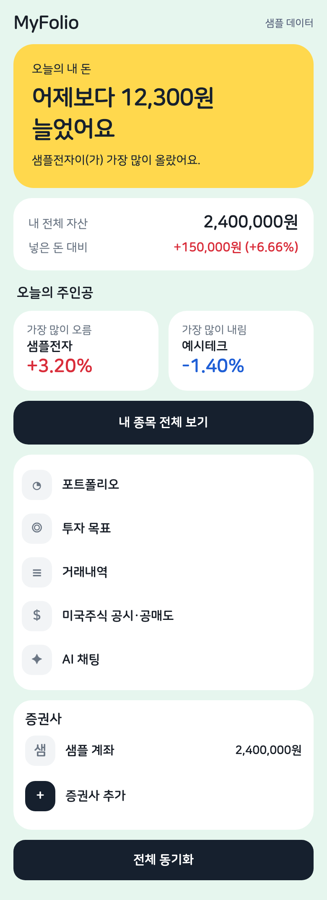
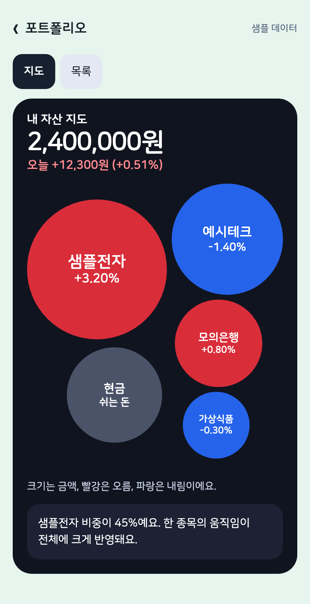
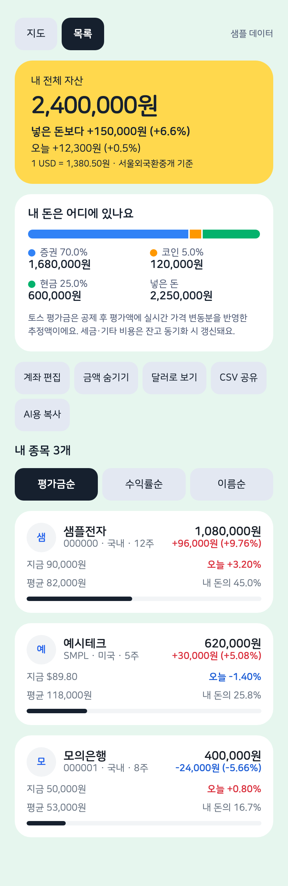
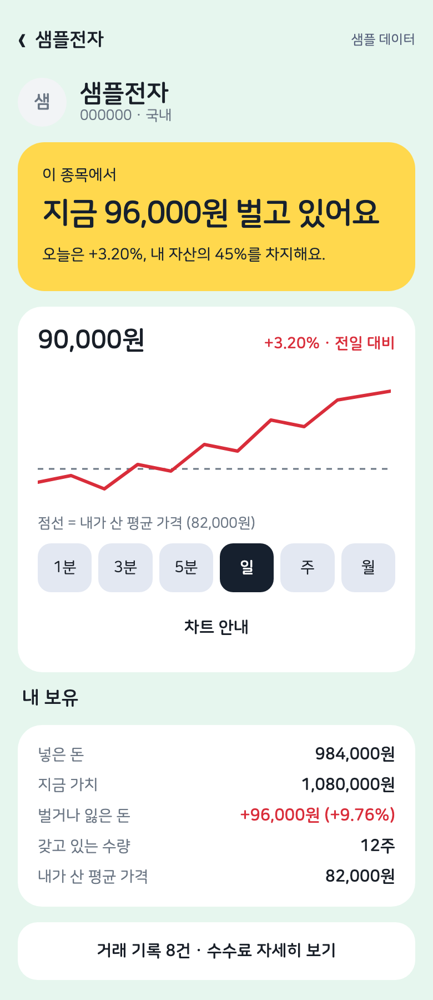
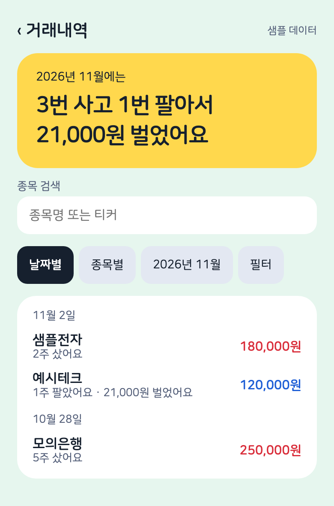
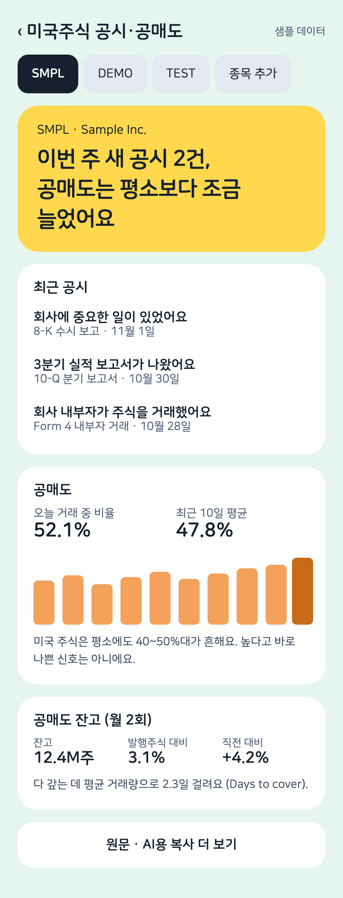
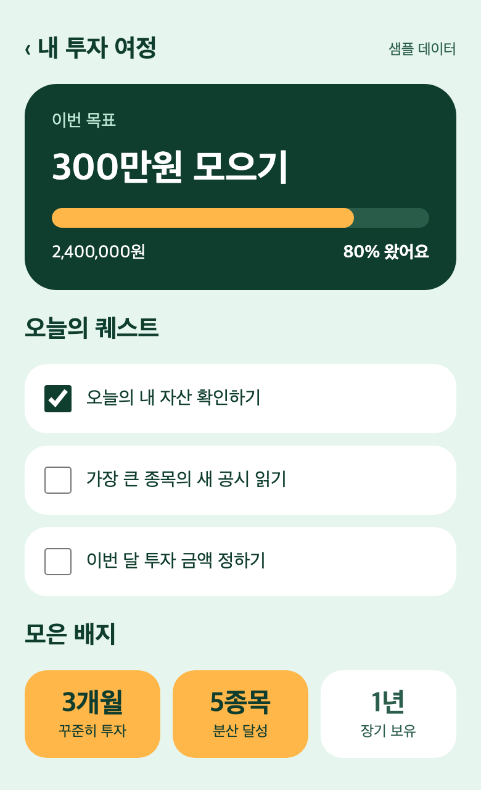
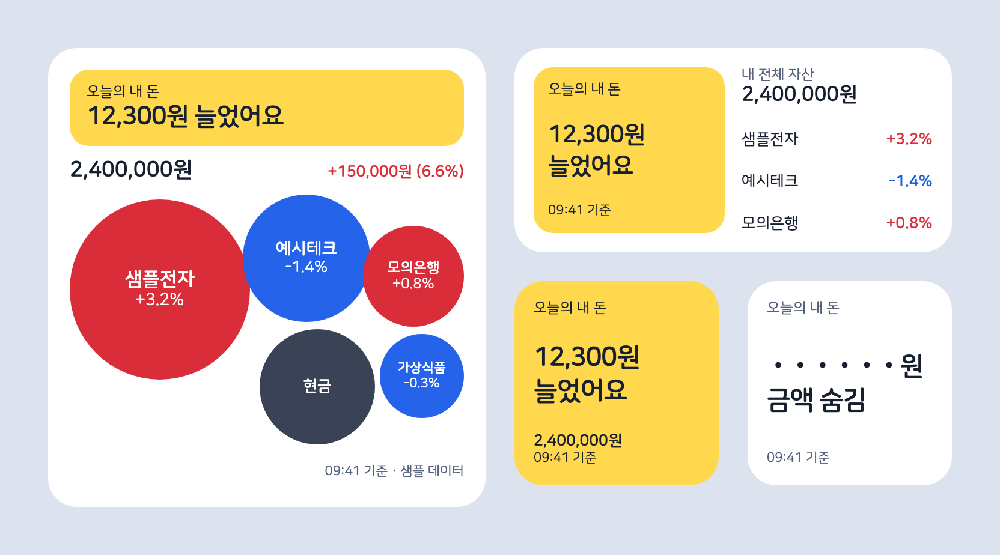

# MyFolio

증권사·거래소 계좌를 API로 연동해 보유 종목·거래내역·손익을 한곳에서 보고,
미국 주식의 SEC 공시와 FINRA 공매도 데이터를 추적하는 macOS·iOS 앱입니다.
(React Native 0.81, react-native-macos, TypeScript)

## 화면

아래 이미지는 샘플 데이터로 만든 예시입니다. 실제 계좌나 시세가 아닙니다.

| 홈                                                                                       | 포트폴리오 지도                                                                                 | 내 종목 전체 보기                                                                 | 종목 상세                                                                    |
| ---------------------------------------------------------------------------------------- | ----------------------------------------------------------------------------------------------- | --------------------------------------------------------------------------------- | ---------------------------------------------------------------------------- |
|  |  |  |  |

| 거래내역                                                                         | 미국주식 공시·공매도                                                       | 투자 목표                                                                      |
| -------------------------------------------------------------------------------- | -------------------------------------------------------------------------- | ------------------------------------------------------------------------------ |
|  |  |  |



## 이용 안내

- **비공식 프로젝트입니다.** 토스증권을 포함한 어떤 증권사·거래소와도 관계가 없고, 이들이 제공하거나 보증하지 않습니다.
- **API 키는 각자 발급해서 사용합니다.** 키는 기기의 Keychain에만 저장되며, 다른 사람에게 공유하면 안 됩니다.
- **이용 약관은 사용자가 직접 지켜야 합니다.** 토스증권 Open API 약관은 시세 정보를 본인 매매 목적으로만 쓰도록 하고, 제3자 제공·배포·상업적 활용을 금지합니다(제5조). 조회 부하가 비정상적이면 이용이 중지될 수 있습니다(제8·9조).
- **시세를 공유하지 마세요.** 실제 시세가 보이는 화면을 공개하거나, 이 앱으로 시세를 다른 사람에게 제공하거나 판매하면 안 됩니다.
- **AI 기능:** "AI용 복사"와 AI 채팅에는 현재 시세, 평가금액, 평가손익, 수익률이 들어가지 않습니다. AI에는 수량, 평균단가, 투자원금, 현금, 실현손익, 체결 내역을 보냅니다. 이 내용은 사용자가 고른 AI 제공자에게 전송됩니다.
- **투자 조언이 아닙니다.** 금액은 추정치이며 증권사 화면과 다를 수 있습니다. 투자 판단과 그 결과는 사용자 책임입니다.

## 설치

배포 파일은 없고, 소스를 받아 직접 빌드합니다.

### 준비물

- Xcode, CocoaPods, Node.js 20 이상이 설치된 Mac
- Apple 개발자 팀 ID (Xcode에 Apple ID로 로그인하면 확인 가능, 무료 계정이면 아이폰 앱은 7일마다 다시 설치해야 합니다)
- 토스증권 계좌 (토스증권을 연결할 때)

### 서명 설정

```sh
git clone https://github.com/0Huns/MyFolio.git
cd MyFolio
cp signing.example.xcconfig signing.local.xcconfig
```

`signing.local.xcconfig`의 `YOUR_TEAM_ID`를 본인의 Apple 팀 ID로 바꿉니다. 이 파일은 Git에 올라가지 않습니다.

### macOS

```sh
npm install
cd macos && pod install && cd ..
npm run build:macos        # build/MyFolio.app 생성 (JS 번들 포함, 개발 인증서 서명)
open build/MyFolio.app
```

개발 중에는 `npm start`로 Metro를 띄우고 `macos/MyFolioRN.xcworkspace`를 Xcode에서 Debug로 실행하면 됩니다.

### iOS (iPhone / iPad)

```sh
npm install
cd ios && pod install && cd ..
npm start                  # Metro
npm run ios                # 시뮬레이터에서 실행 (또는 ios/MyFolioRN.xcworkspace를 Xcode에서 실행)
```

실제 아이폰에 설치하려면 Xcode에서 `ios/MyFolioRN.xcworkspace`를 열고 기기를 선택해 실행하세요.

## 사용 방법

1. **토스증권 연결:** 홈 → 증권사 추가 → 토스증권을 고르고, Client ID와 Client Secret을 입력합니다. 키는 토스증권 WTS의 [설정] → [Open API]에서 약관에 동의하면 발급됩니다. 키는 기기의 Keychain에 저장되며 맥과 아이폰에 각각 입력해야 합니다.
   - **고정 IP 안내:** 앱은 IP를 고정하는 기능이 없습니다. 증권사에 허용 IP를 등록해야 하는데 모바일 데이터나 가정용 인터넷처럼 공인 IP가 바뀌는 환경이라면, 고정 IP를 제공하는 VPN을 각자 준비해 연결하고 그 IP를 허용 IP로 등록하세요.
2. **동기화:** 저장하면 바로 동기화되고, 이후에는 홈 아래의 전체 동기화를 누르거나 설정에서 자동 동기화 간격을 고릅니다.
3. **수동 계좌:** API 없이 쓰려면 증권사 추가에서 수동 계좌를 만들고 종목을 직접 입력합니다.
4. **선택 설정 (설정 화면):**
   - 수출입은행 API 인증키: 원화 환산에 기준환율을 쓸 때
   - SEC 연락처 이메일: 미국 공시를 조회할 때
   - AI API 키: AI 채팅을 쓸 때
5. **맥 위젯:** 앱을 실행한 뒤 macOS 위젯 추가 화면에서 "오늘의 내 돈"을 고릅니다. 앱이 실행 중이어야 값이 갱신됩니다.

## 개발 메모

맥과 아이폰 모두 홈이 메뉴 역할을 하고, 각 화면은 그 위로 열립니다.
CSV 내보내기는 공유 시트로 보냅니다.

iOS는 앱이 닫혀 있으면 타이머가 멈추므로 두 가지로 보완합니다.

- 앱 복귀 시 따라잡기: 포그라운드로 돌아오면 밀린 동기화(설정한 간격 경과 시)를 바로 실행
- 백그라운드 새로고침(`BGAppRefreshTask`, `local.myfolio.rn.refresh`): iOS가 정한 시점에 약 30초 동안 필요 시 동기화.
  실행 간격은 iOS가 사용 패턴·배터리에 따라 결정하며(보통 수십 분~수 시간), 앱을 강제 종료하면 다시 열 때까지 실행되지 않습니다.
  시뮬레이터에서는 동작하지 않으므로 실제 기기에서 확인하세요.

`scripts/build-macos.sh`는 그 팀의 개발 인증서로 서명합니다(다른 팀이면 빌드 실패). 서명이 고정돼 다시 빌드해도 키체인 접근을 다시 묻지 않고,
데스크톱 위젯(`macos/MyFolioWidget`, App Group `<팀 ID>.local.myfolio.rn`)이 동작합니다. 위젯은 앱이 1분마다 저장하는 `widget.json`을 읽으므로 앱이 실행 중이어야 갱신됩니다.

`scripts/build-macos.sh`는 Xcode의 JS 번들링 단계를 건너뛰고(`SKIP_BUNDLING=1`) 스크립트에서 직접 번들링합니다.
(프로젝트 경로에 한글 등 비ASCII 문자가 있으면 Xcode 단계에서 macOS 플랫폼 인식이 실패하기 때문)

## 기능

| 영역       | 내용                                                                         |
| ---------- | ---------------------------------------------------------------------------- |
| 계좌 연동  | 토스증권, 수동 계좌 (한국투자증권·키움증권·업비트·빗썸·코인원은 준비중)      |
| 포트폴리오 | 계좌 통합, 평가금액·손익·비중, 검색/필터/정렬, CSV 내보내기, 금액 숨기기     |
| 거래내역   | 평균단가 기준 실현손익, 종목별 상세, 초기화 후 재동기화                      |
| 미국주식   | SEC EDGAR 공시 목록, FINRA 일별 공매도 비율, 공매도 잔고                     |
| AI 채팅    | 본인 API 키로 Claude(`claude-opus-5-5`) 또는 OpenAI                          |
| 투자 목표  | 목표 진행률, 오늘의 퀘스트, 습관 배지                                        |
| 기타       | 백그라운드 자동 동기화, 라이트/다크 모드, 데이터 초기화, macOS 데스크톱 위젯 |

- API 키: macOS Keychain (`MFNative` 네이티브 모듈)
- 데이터: `~/Library/Containers/local.myfolio.rn/Data/Library/Application Support/MyFolio/data.json`
- SEC EDGAR는 User-Agent에 연락처가 필요합니다 → 설정에서 이메일을 입력하세요.

## 구조

```
App.tsx                  앱 셸 (화면 전환, 계좌 편집 시트)
index.js                 진입점
src/
  api/                   외부 요청 전부: http 클라이언트, 시세, 환율, SEC/FINRA, AI
    brokers/             증권사·거래소 API (KIS, 키움, 토스, 업비트 등)
  domain/                순수 계산과 타입: 평가금·손익, 거래 집계, 차트, 시장 날짜, 공시 라벨
  platform/              네이티브 브리지 (키체인, 파일, 공유)
  store/                 AppState(상태·저장), 기능별 서비스(Sync, Quotes, ExchangeRates, History 등),
                         조립과 훅(store.ts), 내보내기·AI 요약(reports.ts)
  navigation/            페이지 목록, 홈, 동기화 상태
  screens/               화면 (asset/, accounts/, us/ 는 전용 컴포넌트 포함)
  ui/                    공용 UI (테마, 글자, 컨트롤, 시트, 표, 차트)
  utils/                 오류, 파싱, 날짜, 포맷
native/                  iOS·macOS 공용 네이티브 모듈
ios/, macos/             Xcode 프로젝트 (macos/ 에 데스크톱 위젯 포함)
scripts/                 빌드 스크립트
tests/                   `npm test`
```

의존 방향은 `screens → store → api → domain·utils` 입니다. 스토어 안에서는
`Sync → Quotes → ExchangeRates → BrokerClients → AppState` 한 방향이고, 실시간 가격이 없는 화면은
`useStoreData()`로 체결마다 다시 그려지지 않게 합니다. 화면은 `api/`를 직접 쓰지 않고,
`domain/`과 `utils/`는 React와 외부 호출을 모릅니다.

## 글꼴

앱과 위젯은 [나눔스퀘어라운드](https://hangeul.naver.com)를 사용합니다. 저작권은 네이버와 네이버 문화재단에 있으며, 네이버가 [SIL Open Font License](https://github.com/naver/nanumfont)로 공개한 글꼴입니다. 라이선스는 `assets/fonts/NanumSquareRound-LICENSE.txt`에 있습니다.
